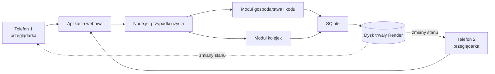

# Architektura aplikacji Domowe obowiązki

**Status:** wybrany kształt pierwszej wersji; szczegóły decyzji w [ADR 0001](docs/adr/0001-render-sqlite.md)  \
**Źródło wymagań:** GitHub issue [#1 — Specyfikacja: kolejka obowiązków domowych](https://github.com/AleksandraZiembaMrozowska/gdd-practice/issues/1)  \
**Zakres:** pierwsza wersja aplikacji; hosting Render, aplikacja Node.js i trwały magazyn SQLite

## Cel produktu

Aplikacja jest wspólną, responsywną stroną internetową dla dwóch osób w gospodarstwie domowym. Utrzymuje wspólną kolejkę dla pięciu stałych obowiązków:

1. Opróżnianie zmywarki
2. Mycie łazienki
3. Mycie podłogi
4. Mycie kuchni
5. Wynoszenie śmieci

Dla każdego obowiązku aplikacja pokazuje osobę, której wypada kolej, oraz osobę, która wykonała go ostatnio. Główną regułą jest kolejka przypisana do zadania, a nie bilans czasu ani wysiłku.

## Założenia i ograniczenia

- Gospodarstwo ma dokładnie dwa profile. Konta e-mail ani osobna natywna aplikacja nie są wymagane.
- Osoba dołącza do gospodarstwa przez prywatny kod. Każdy telefon zapamiętuje wybrany profil; przy oznaczaniu wykonania można wskazać profil faktycznego wykonawcy.
- Początkową kolej ustawia się osobno dla każdego zadania. Dla zmywarki pierwsza kolej przypada mężowi.
- Lista zadań jest stała. Użytkownicy nie dodają własnych zadań.
- Aplikacja nie przechowuje pełnej historii wykonań ani dat, nie obsługuje terminów, harmonogramów, przypomnień ani checklist.
- Repozytorium nie zawiera jeszcze implementacji. Ten dokument opisuje proponowany kształt, a nie istniejące moduły.

## Wybrana architektura

Pierwsza wersja działa jako jedna usługa webowa Node.js na Render. Stan gospodarstw i sesji zapisuje SQLite na dołączonym dysku trwałym pod `/var/data/households.sqlite`. Baza jest jedynym źródłem prawdy. Każda przeglądarka ma własną sesję w bezpiecznym ciasteczku, a wybór profilu jest zapisany przy tej sesji.

Klienci odczytują wspólny stan przez API. Odświeżenie pobiera najnowszy zapis z SQLite. Aktualizacje na żywo między otwartymi ekranami pozostają osobną decyzją; w pierwszej wersji nie zastępują trwałego zapisu w magazynie.

## Moduły

Pojęcia Module, Interface, Implementation, Seam i Adapter używają znaczeń z zasad codebase-design: interfejs ukrywa szczegóły implementacji, a adapter realizuje ten interfejs w konkretnym środowisku.

| Moduł | Odpowiedzialność |
| --- | --- |
| Klient webowy | Ekran dołączenia lub utworzenia gospodarstwa, wybór profilu, konfiguracja pierwszej kolejki oraz lista pięciu zadań. Pokazuje aktualną kolej i ostatniego wykonawcę. |
| Gospodarstwo i dostęp | Tworzenie wspólnej przestrzeni, wydanie prywatnego kodu, dołączanie drugiej osoby i utrzymanie dwóch profili. |
| Stały katalog zadań | Dostarcza pięć nazw i stabilnych identyfikatorów zadań. Katalog nie jest edytowany przez użytkowników. |
| Kolejki i wykonanie | Odczytuje stan kolejki i obsługuje oznaczenie wykonania wraz z faktycznym wykonawcą. Zawiera jedną regułę zmiany kolejki opisaną niżej. |
| Adapter przechowywania i synchronizacji | Trwale zapisuje stan gospodarstwa i zadania oraz udostępnia zmiany klientom. Ukrywa wybraną bazę i mechanizm synchronizacji przed modułami aplikacji. |

Klient webowy wywołuje przypadki użycia, zamiast samodzielnie stosować reguły kolejki. Moduł kolejek nie zależy od konkretnego dostawcy bazy. Wymiana dostawcy odbywa się za interfejsem adaptera przechowywania.

## Model danych

| Rekord | Najważniejsze pola | Uwagi |
| --- | --- | --- |
| Gospodarstwo | identyfikator, skrót prywatnego kodu lub równoważny bezpieczny identyfikator dostępu | Kod służy do dołączenia do wspólnej przestrzeni. |
| Profil domownika | identyfikator, identyfikator gospodarstwa, nazwa wyświetlana, pozycja jednego z dwóch profili | Wybrany profil na danym telefonie można zapamiętać w pamięci przeglądarki. |
| Definicja zadania | stały identyfikator, nazwa, kolejność wyświetlania | Pięć definicji jest częścią aplikacji, nie edytowalnymi rekordami użytkownika. |
| Stan kolejki | identyfikator gospodarstwa, identyfikator zadania, profil aktualnie przypisany do kolejki, profil ostatniego wykonawcy | Jeden rekord na zadanie w gospodarstwie. Ostatni wykonawca jest pusty przed pierwszym wykonaniem. |

Stan kolejki jest zapisywany osobno dla każdej kombinacji gospodarstwo–zadanie. Nie zapisujemy dat wykonania ani pełnego dziennika zdarzeń, ponieważ nie są potrzebne w pierwszej wersji.

## Reguła wykonania zadania

Komenda oznaczenia zadania zawiera identyfikator zadania oraz profil faktycznego wykonawcy. Moduł kolejek wykonuje atomową zmianę jednego rekordu:

1. Zapisuje wykonawcę jako ostatnią osobę, która wykonała zadanie.
2. Jeśli wykonawca jest osobą, której wypadała kolej, przekazuje kolej drugiej osobie.
3. Jeśli wykonał je drugi domownik, pozostawia kolej przy dotychczas przypisanej osobie.
4. Zapisuje nowy stan i udostępnia go obu telefonom.

Zmiana wykonawcy i ewentualna zmiana kolejki muszą być jedną transakcją, by odświeżenie albo jednoczesny dostęp z dwóch telefonów nie pozostawiły częściowo zmienionego stanu. Aplikacja ogranicza wielokrotne wysłanie tego samego działania przez blokadę przycisku podczas zapisu; wybrana baza powinna obsługiwać atomowe aktualizacje.

## Dostęp i prywatność

- Prywatny kod ma 128 bitów losowości. Baza przechowuje jego skrót SHA-256, a interfejs pokazuje kod tylko po utworzeniu gospodarstwa.
- Dołączanie ogranicza się do pięciu prób z danego adresu IP w ciągu 15 minut. Serwer nie zapisuje treści żądań ani kodów w logach.
- Telefon zapamiętuje wybór profilu w osobnej sesji. Ciasteczko sesji ma flagi `HttpOnly` i `SameSite=Strict`, a w produkcji także `Secure`.
- Każdy odczyt i zapis stanu kolejki musi być ograniczony do gospodarstwa uzyskanego przez poprawny kod dostępu.
- Nie logujemy kodów dostępu ani zbędnych danych osobowych.

Sposób zmiany lub unieważnienia kodu oraz okres przechowywania danych pozostają do ustalenia.

## Wdrożenie i synchronizacja

Usługa Render powinna działać jako jedna instancja z dyskiem trwałym zamontowanym pod `/var/data`. Wszystkie pliki SQLite, w tym pliki dziennika WAL, pozostają pod tym katalogiem. Transakcje SQLite służą do atomowych zmian stanu. Nie należy skalować usługi do wielu instancji z lokalnym dyskiem; przy takim wymaganiu trzeba przejść na wspólną bazę, na przykład PostgreSQL.

Na start nie są potrzebne osobne procesy robocze, kolejki wiadomości ani mikroserwisy. Nie ma harmonogramów do uruchamiania ani powiadomień do wysyłania.

## Weryfikacja zachowania

Zatwierdzony scenariusz end-to-end z issue #1 powinien użyć dwóch klientów przeglądarkowych dołączonych do tego samego gospodarstwa. Sprawdza on:

- konfigurację dwóch profili i pięciu zadań;
- pierwszą kolej męża przy zmywarce i niezależne ustawienie początkowej kolejki dla pozostałych zadań;
- przekazanie kolejki po wykonaniu zadania przez przypisaną osobę;
- pozostawienie kolejki bez zmian po wykonaniu zadania przez partnera;
- aktualizację ostatniego wykonawcy;
- synchronizację między telefonami i zachowanie stanu po odświeżeniu.

Test powinien sprawdzać widoczne zachowanie przez granicę aplikacji, bez uzależniania się od prywatnych szczegółów adaptera bazy.

## Otwarte decyzje techniczne

1. Mechanizm synchronizacji zmian w czasie zbliżonym do rzeczywistego.
2. Rotacja i unieważnianie prywatnego kodu.
3. Procedura kopii zapasowej i okres przechowywania danych.

Te decyzje nie zmieniają reguł produktu. Trwały wybór hostingu i bazy opisuje [ADR 0001](docs/adr/0001-render-sqlite.md).
